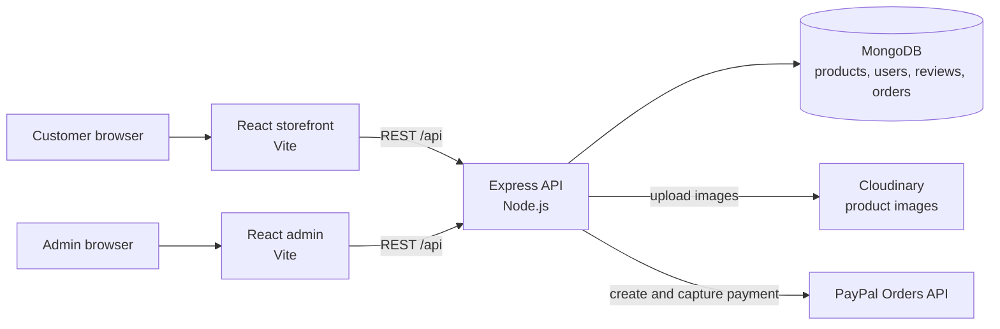
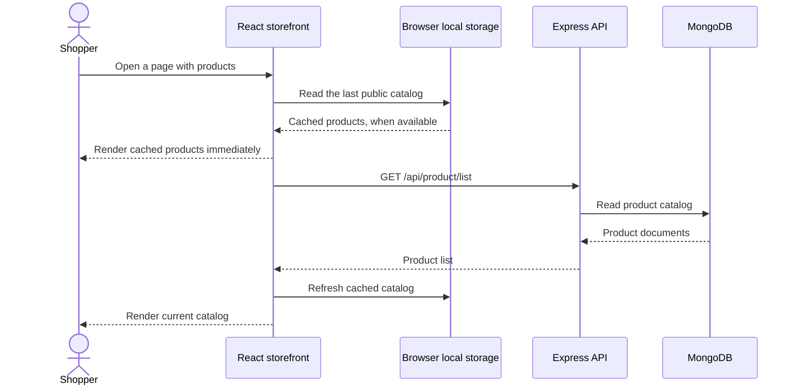
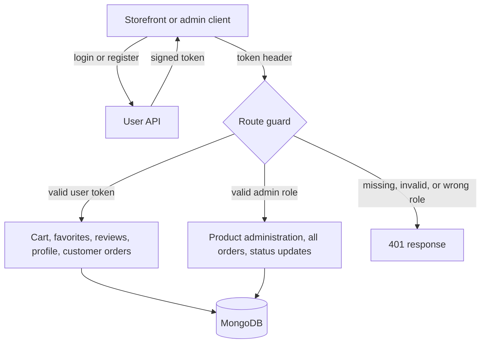
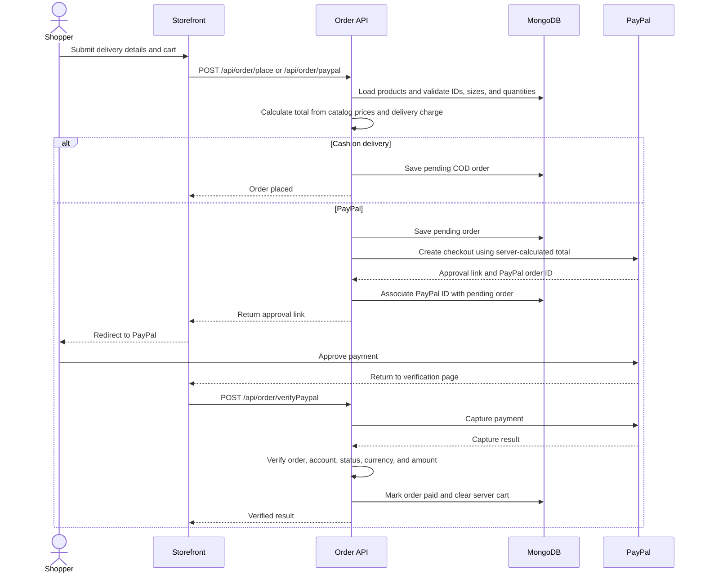

# Technical Overview

This document describes how the Forever Store applications exchange data and how the main shopping flows work. The source code remains the authoritative implementation.

## System architecture

The three applications can be deployed independently. The storefront and admin dashboard are browser clients. The API owns authorization, persistence, image upload coordination, and payment verification.

## Catalog loading and shopping

Search, category/type filters, sorting, favorites, and related-product selection run in the storefront against the catalog data. Favorite changes and reviews are persisted by authenticated API requests. A guest cart is stored locally; after sign-in, the storefront merges its quantities into the user's server cart.

## Authentication and authorization

User and admin routes verify signed tokens in backend middleware. Admin routes additionally require the admin role. Product listing and review reading are public; review submission requires a signed-in user.

## Order and payment flow

The browser's submitted price is not trusted for checkout totals. The API reloads product records and calculates the order amount itself. PayPal orders are marked paid only after capture is confirmed against the stored order and expected amount.

## Main API routes

| Area | Routes | Access |
| --- | --- | --- |
| Accounts | `POST /api/user/register`, `POST /api/user/login`, `GET /api/user/profile` | Public for sign-in and registration; profile requires a user token |
| Products | `GET /api/product/list`, `GET /api/product/:productId/reviews` | Public |
| Reviews | `POST /api/product/:productId/reviews` | User token |
| Cart | `POST /api/cart/get`, `/add`, `/update` | User token |
| Favorites | `GET /api/favorites`, `POST /api/favorites` | User token |
| Customer orders | `POST /api/order/place`, `/paypal`, `/userorders`, `/verifyPaypal` | User token |
| Store administration | `POST /api/product/add`, `/remove`; `POST /api/order/list`, `/status` | Admin token |

The API defaults to port 4000. The Vite development servers default to 5173 for the storefront and 5174 for admin. The repository pins Node.js 24.22.3 in `.nvmrc` and declares Node.js 24 compatibility in each app.
